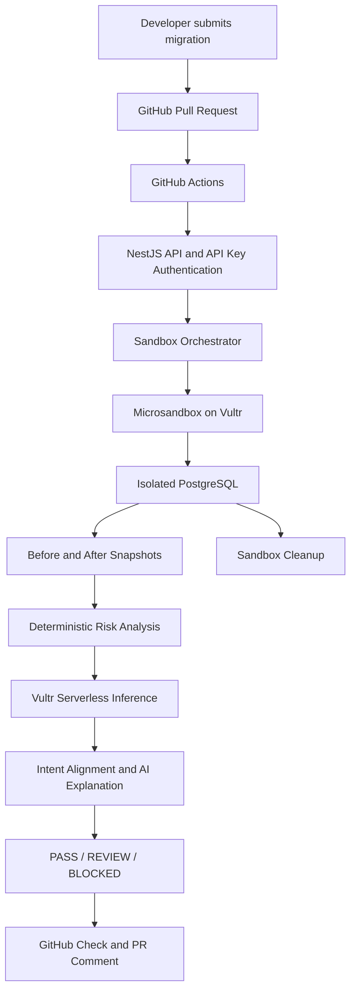

# SchemaSentry
### Built by Team: SchemaGuard

**Isolated database migration verification with evidence-backed, intent-aware risk analysis.**

SchemaSentry helps developers evaluate database migrations before they reach production. It executes submitted SQL against a disposable PostgreSQL environment, compares the database state before and after execution, calculates deterministic risk, and uses AI to explain the findings and assess whether the migration matches its stated intent.

It also integrates with GitHub Actions to automatically evaluate SQL migration files in pull requests and publish the result as a PR comment and CI check.

## The problem

A database migration can be syntactically valid and still cause serious problems:

- Dropping a column can permanently remove existing data.
- Changing a column's type can break dependent application behavior.
- Adding a `NOT NULL` column without a default can fail against existing records.
- Reducing a table's row count can indicate unintended data loss.

Traditional SQL validation does not necessarily reveal the impact of a migration on existing data.

SchemaSentry focuses on testing the actual database changes in an isolated environment before allowing a migration to progress through the review process.

## How it works

1. **Migration submission:** A developer submits SQL along with optional intent and expected-impact descriptions.
2. **Sandbox creation:** SchemaSentry creates a disposable PostgreSQL environment using Microsandbox.
3. **Baseline initialization:** A synthetic database schema and sample records are created.
4. **Migration execution:** The submitted SQL runs inside the isolated environment.
5. **Snapshot comparison:** SchemaSentry captures the database state before and after execution.
6. **Deterministic risk analysis:** A rule-based engine evaluates schema and data changes.
7. **AI explanation:** Vultr Serverless Inference provides a human-readable explanation and evaluates alignment with the stated intent.
8. **Decision:** SchemaSentry returns a PASS, REVIEW, or BLOCKED gate.
9. **Cleanup:** The disposable sandbox is removed after execution.

## Architecture



The AI explanation layer does not determine or override the deterministic risk classification or deployment gate.

## Risk and decision model

SchemaSentry separates technical risk from intent alignment and the final decision.

| Risk level | Decision gate | Meaning |
|---|---|---|
| NONE | PASS | No detected risk |
| LOW | PASS | Low-impact changes detected |
| MEDIUM | REVIEW | Human review is recommended |
| HIGH | BLOCKED | High-risk changes are blocked |

Examples of changes considered by the deterministic analysis engine:

| Database change | Example assessment |
|---|---|
| Column removal | HIGH when existing non-null values are present; otherwise MEDIUM |
| Column type change | HIGH |
| Restricting nullability to NOT NULL | HIGH |
| Default value change | LOW |
| Adding a NOT NULL column without a default to an existing table | HIGH |
| Adding a table | LOW |
| Removing a table | HIGH |
| Decreasing row count | HIGH |
| Increasing null values | HIGH |

These rules are based on observed database changes. They are not a complete analysis of every possible database or application-level dependency.

### Intent-aware AI explanation

A migration can be intentionally destructive. For example, removing an obsolete column may be a valid business decision even though it carries a high technical risk.

SchemaSentry therefore distinguishes:

- **Technical risk:** What changed and what potential consequences were detected?
- **Intent alignment:** Does the observed change match the developer's stated intent?
- **Decision gate:** What action should the CI workflow take based on deterministic risk?

The AI layer receives the SQL, stated intent, expected impact, and available analysis evidence.

It returns:
- A human-readable explanation.
- Intent alignment: `MATCHES`, `PARTIAL`, `MISMATCH`, or `UNKNOWN`.
- Potential consequences.
- A recommendation.

AI output is explanatory. It cannot lower a deterministic risk level, override a decision gate, or authorize a destructive migration.

If inference is unavailable, the deterministic analysis can still return a result without an AI explanation.

## Isolation with Microsandbox

Migration execution takes place in disposable PostgreSQL environments managed through Microsandbox.

Current sandbox configuration:

- PostgreSQL image: `postgres:16-alpine`
- CPU allocation: 1 CPU
- Memory allocation: 1 GB
- Network access: Disabled (`--no-net`)
- Idle timeout: 30 minutes
- Maximum duration: 1 hour
- Project and purpose labels for sandbox identification

The sandbox runs in a microVM with a separate guest kernel. The API server communicates with the sandbox host through SSH.

Each migration submitted to the main analysis-and-execution workflow receives a fresh sandbox. The sandbox is removed after the operation, including when migration execution fails.

This design limits the execution environment's exposure and prevents submitted SQL from being run directly against the application's production database.

## GitHub Actions integration

SchemaSentry includes a GitHub Actions workflow:

`.github/workflows/schemasentry.yml`

The workflow runs when relevant SQL migration files are added or updated in a pull request targeting `main`.

### Workflow behavior

1. Detects changed SQL files under `migrations/`.
2. Reads optional migration metadata from SQL comments.
3. Sends each migration to the SchemaSentry API.
4. Receives the deterministic risk gate and AI explanation.
5. Creates or updates a comment on the pull request.
6. Reports the result through the GitHub Actions check.

Each SQL migration file is evaluated independently in its own fresh sandbox. The workflow does not currently execute multiple changed migration files as one sequential database migration batch.

### Migration metadata

Developers can provide intent and expected impact using SQL comments:

```sql
-- intent: Add a deployment note to the database.
-- expected-impact: Add a nullable column without modifying existing records.

ALTER TABLE users
ADD COLUMN deployment_note TEXT;
```

The metadata is optional, but providing it improves the usefulness of intent-alignment analysis.

### Configure GitHub secrets

Add the following repository secrets:

| Secret | Description |
|---|---|
| `SCHEMASENTRY_API_URL` | Public base URL of the deployed SchemaSentry API |
| `SCHEMASENTRY_API_KEY` | API authentication key |

The workflow uses these secrets to communicate securely with the API. Do not commit API keys or other credentials to the repository.

### CI decision behavior

- `PASS`: The check succeeds.
- `REVIEW`: The check reports a review warning.
- `BLOCKED`: The check fails.
- API or workflow errors: The check fails.

## API

The backend is implemented using NestJS and TypeScript.

### Main endpoint

`POST /migrations/analyze-and-execute`

Accepts a migration, executes it in a disposable sandbox, compares the database snapshots, and returns the analysis.

Example request:

```json
{
  "sql": "ALTER TABLE users ADD COLUMN deployment_note TEXT;",
  "intent": "Add an optional deployment note to users.",
  "expectedImpact": "Add a nullable column without modifying existing records."
}
```

Example response structure:

```json
{
  "risk": "LOW",
  "gate": "PASS",
  "execution": {
    "status": "EXECUTED"
  },
  "comparison": {
    "before": {},
    "after": {},
    "changes": []
  },
  "aiExplanation": {
    "alignment": "MATCHES",
    "explanation": "The observed database change matches the stated intent.",
    "recommendation": "Proceed with the normal review process."
  }
}
```

The response above is illustrative. Actual comparison and explanation fields depend on the submitted migration and analysis results.

### Additional endpoints

| Method | Endpoint | Purpose |
|---|---|---|
| GET | `/health` | API health check |
| POST | `/migrations/analyze` | Analyze migration risk |
| POST | `/migrations/execute` | Execute SQL against the configured test sandbox |
| POST | `/migrations/compare` | Compare database snapshots |
| GET | `/migrations/sandbox/version` | Inspect sandbox PostgreSQL version |
| GET | `/migrations/sandbox/schema` | Inspect sandbox schema |
| GET | `/migrations/sandbox/stats` | Inspect sandbox statistics |
| GET | `/migrations/sandbox/snapshot` | Retrieve sandbox snapshot |

The sandbox inspection endpoints are intended for development and testing.

### Authentication

API endpoints are protected using bearer-token authentication through `API_ACCESS_KEY`, with the health endpoint exempted.

Example:

```http
Authorization: Bearer YOUR_API_ACCESS_KEY
```

## Technology stack

| Component | Technology |
|---|---|
| Backend API | NestJS, Node.js, TypeScript |
| Database | PostgreSQL 16 |
| Isolation | Microsandbox, KVM |
| Sandbox communication | SSH2 |
| AI inference | Vultr Serverless Inference |
| AI integration | OpenAI-compatible chat completions API |
| CI/CD | GitHub Actions |
| Infrastructure | Vultr Cloud Compute |
| Frontend foundation | Next.js, React, Tailwind CSS |

## Running locally

### Prerequisites

- Node.js 22 or compatible version.
- pnpm 12.16.1.
- Linux host with KVM support for local Microsandbox execution.
- Microsandbox installed and configured.
- PostgreSQL sandbox image available.
- Vultr Serverless Inference API key for AI explanations.

The sandbox orchestration currently relies on a Linux host with KVM support and SSH access to the Microsandbox host.

### Install dependencies

```bash
pnpm install --frozen-lockfile
```

### Configure environment variables

Configure the following variables in the API environment:

```env
PORT=4000

API_ACCESS_KEY=your_api_access_key

VULTR_INFERENCE_API_KEY=your_vultr_inference_api_key
VULTR_INFERENCE_MODEL=glm-5.3-flash

SANDBOX_SSH_HOST=127.0.0.1
SANDBOX_SSH_USER=your_sandbox_user
SANDBOX_SSH_KEY_PATH=/path/to/your/ssh/key

OBSERVE_APP_KEY=
OBSERVE_APP_SECRET=
```

Use the actual SSH host, username, and key path for your environment. Keep all secrets outside version control.

AI inference credentials are required for AI explanations, but deterministic analysis can still operate when inference is unavailable.

### Build the API

```bash
pnpm --dir apps/api build
```

### Start the API in development mode

```bash
pnpm --dir apps/api start:dev
```

The default API port is `4000`.

### Run API tests

```bash
pnpm --dir apps/api test
```

## Deployment

The backend is deployed on Vultr Cloud Compute running Ubuntu 24.04.

The deployment uses:

- A dedicated Vultr Cloud Compute instance.
- Microsandbox for isolated PostgreSQL execution.
- A systemd service for the NestJS API.
- SSH loopback communication between the API and sandbox host.
- Cloudflare Tunnel for public API access during demonstration.

The public demonstration URL is environment-dependent. Configure the current deployed API URL in the GitHub repository secret `SCHEMASENTRY_API_URL`.

## Current limitations

SchemaSentry is a hackathon MVP and is not yet a production database migration platform.

Current limitations include:

- Analysis uses a synthetic baseline database with a sample `users` table and three sample records.
- Snapshot comparison currently focuses on the public schema and selected data statistics.
- Application-level dependencies, stored procedures, triggers, and all possible database behaviors are not comprehensively analyzed.
- Multiple changed migration files are evaluated independently, not as a sequential migration batch.
- AI explanations depend on inference availability and should be treated as advisory.
- The frontend is currently a development foundation rather than a completed user-facing dashboard.
- The deterministic risk rules are intentionally conservative and may require human review for legitimate destructive changes.

SchemaSentry does not guarantee that a migration is safe for every production workload. It provides an isolated execution environment and evidence-based analysis to improve migration review.

## Repository structure

```text
SchemaSentry/
├── .github/
│   └── workflows/
│       └── schemasentry.yml
├── apps/
│   ├── api/
│   │   └── src/
│   │       ├── auth/
│   │       ├── health/
│   │       └── migrations/
│   └── web/
├── migrations/
│   └── 2026-11-07-add-deployment-note.sql
├── pnpm-workspace.yaml
├── package.json
└── README.md
```

## Screenshots
- Process isolation
    - Process isolation runs each migration in its own disposable environment, preventing one test from affecting another.
    
    
- Safe migration
- 
  

- Risky migration
- 
- 


## Project

Built for the **LabLab × Vultr Agent Rush** hackathon.

**Challenge:** Blast Radius Zero

**Core idea:** Execute database migrations in isolated microVMs, compare their actual effects, and combine deterministic risk analysis with AI-powered intent explanations to support safer database change reviews.
